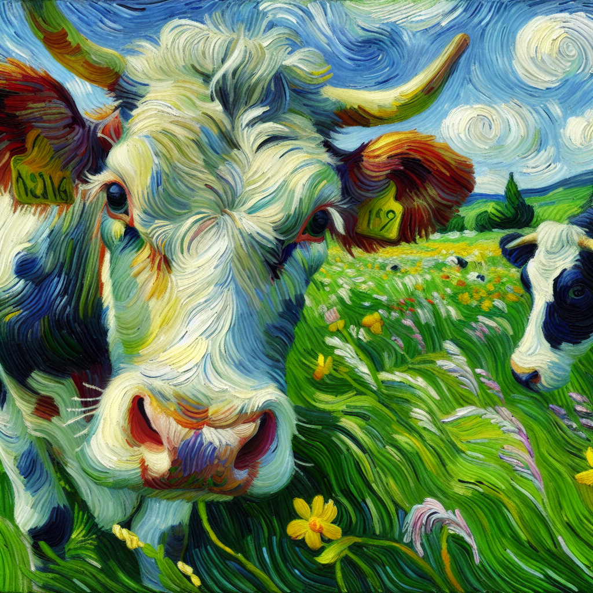

# Stylize MCP Server

[](https://github.com/BryceEWatson/stylize-mcp-server/actions/workflows/ci.yml)
[](https://www.python.org/downloads/)
[](LICENSE)
[](#status)

A Python image-stylization service that AI assistants call over MCP (the Model Context Protocol), with a REST API and a small web UI on the same FastAPI app. You send a photo or a text prompt and pick one of five styles (or let it pick four at random), and it returns generated images stored in Google Cloud Storage. Anonymous users get a five-image trial before they have to sign up.



*Sample output from the `van_gogh` style, saved while the service was running.*

## Status

I built and ran this in May and June 2025. The hosted demo on Cloud Run was taken offline in June 2026 and nothing is deployed now, so there's no live URL. The code is here as a reference implementation. The unit tests and lint run offline in CI against dependency versions pinned to June 2025 ([`requirements-lock.txt`](requirements-lock.txt)).

## What's in the code

- **MCP server** ([`app/mcp_server.py`](app/mcp_server.py), built on FastMCP and mounted at `/mcp`). Six tools: `stylize_image`, `generate_image_from_text`, `list_styles`, `get_style_details`, `start_trial_session` and `check_trial_status`. `stylize_image` accepts an API key or a trial session ID; `generate_image_from_text` takes only an API key.
- **REST API** ([`app/main.py`](app/main.py)): `/stylize_image`, `/styles`, account registration and login (JWT), API-key management, trial status and conversion, and credit balance and purchase.
- **Image pipeline** ([`app/openai_service.py`](app/openai_service.py)). For an uploaded photo, GPT-4o describes the image, and DALL·E 3 generates a new one from that description plus the style prompt. DALL·E 3 can't edit an image, so the result is a reinterpretation, not a filter over the original pixels. Leaving out `style_id` generates four random styles, and those count as four images against the quota.
- **Style catalog** ([`app/styles.json`](app/styles.json)): `van_gogh`, `pixel_art`, `flat_ui_icon`, `neumorphic_button` and `glassmorphic_card`.
- **Trial and credits** ([`app/trial_service.py`](app/trial_service.py), [`app/user_service.py`](app/user_service.py)). Trial sessions, accounts and credit balances live in Firestore. The four credit packages are defined in code.
- **Abuse-prevention services**: device fingerprinting, VPN and proxy detection, behavior analysis, risk scoring, rate limiting and abuse-event monitoring, each in its own `app/*_service.py` module with unit tests. They're built but not connected to live traffic (see Known limitations).
- **Infrastructure**: Terraform for the GCP project in [`infra/`](infra/) and a Cloud Build pipeline ([`cloudbuild.yaml`](cloudbuild.yaml)) that builds the Docker image and deploys it to Cloud Run. GitHub Actions never deploys.

## Known limitations

I'm listing these because a reader evaluating the code should know them before trusting any feature list, mine included.

- **No payment processing.** `purchase_credits` adds credits to the balance without charging anyone. The request model has a field for a Stripe payment method ID, but no Stripe code exists.
- **Abuse prevention never runs on real requests.** The trial service only uses those services when `SECURITY_ENABLED=true` *and* the caller passes the incoming request object. No route passes it, so even with the flag on, no fingerprinting, VPN check or rate limit applies.
- **CAPTCHA verification isn't wired up.** [`app/captcha_service.py`](app/captcha_service.py) can verify reCAPTCHA and hCaptcha tokens and pick a challenge level from a risk score, but no request handler verifies a CAPTCHA response. [`app/protection_middleware.py`](app/protection_middleware.py) isn't mounted on the app either.
- **No content moderation.** The Cloud Vision client library is in `requirements.txt`, but no code calls SafeSearch.
- **Signed URLs can fall back to public URLs.** If signing fails, [`GcsService.generate_signed_url`](app/gcs_service.py) logs a warning and returns a plain public object URL, which only works if the bucket is public. A tighter version would fail closed.
- **CORS is wide open.** The app allows every origin with credentials, which the code comments flag as a development setting.
- **MCP trial sessions are shared.** MCP doesn't pass a client IP, so `start_trial_session` uses the fixed address `mcp-client`. With Firestore, every MCP caller gets the same active session for 24 hours, so they share one five-image pool and can see each other's session ID.
- **Several paths fail open.** If creating or looking up a trial session throws (a Firestore error, say), the service returns a new unsaved session instead of refusing. MCP API-key checks pass when the auth service is unavailable or auth is disabled.
- **No Redis caching.** Redis is configurable, but nothing caches responses.
- **The E2E suite hasn't run since the demo went offline.** It's in [`tests/e2e/`](tests/e2e/) and runs only on manual dispatch.

## Run it locally

You need Python 3.10 to 3.12. Image generation also needs an OpenAI API key and a GCP project with Firestore and Cloud Storage. Without those, the app starts and `/health` responds, but routes that touch storage fail.

```bash
python -m venv venv
source venv/bin/activate          # Windows: venv\Scripts\activate
pip install -r requirements-lock.txt

cp .env.example .env              # then fill in OPENAI_API_KEY and GCP_PROJECT_ID
uvicorn app.main:app --reload --port 8080
```

Then:

```bash
curl http://localhost:8080/health

# One style
curl -X POST http://localhost:8080/stylize_image \
  -F "style_id=van_gogh" \
  -F "user_prompt=a cow in a meadow"

# Four random styles (counts as four images)
curl -X POST http://localhost:8080/stylize_image \
  -F "user_prompt=a cow in a meadow"
```

The MCP server speaks streamable HTTP at `http://localhost:8080/mcp/`. [docs/developer-guide/mcp-integration.md](docs/developer-guide/mcp-integration.md) has client examples, but they use an `/mcp/sse` URL from an older setup. With the pinned FastMCP version, the endpoint is `/mcp/`.

## Tests

The unit tests mock OpenAI and every Google Cloud service, so they need no credentials or network:

```bash
pip install -r requirements-lock.txt ruff==0.11.13 pytest-timeout==2.4.0
ruff check app/ tests/
pytest tests --ignore=tests/e2e --timeout=120
```

CI runs the same commands on Python 3.10, 3.11 and 3.12 for every push and pull request to `main`, along with a Trivy filesystem scan. The Docker image build runs on pushes to `main`. None of these jobs reads a repository secret.

## Repository layout

```
app/        FastAPI app, MCP server, services, web templates
tests/      unit tests; tests/e2e/ holds the Docker-based end-to-end suite
infra/      Terraform for the GCP project
scripts/    API-key CLI (manage_api_keys.py), import check, E2E runner, smoke tests
docs/       API reference, MCP integration, deployment and security notes
docs/archive/  demo walkthroughs written for the hosted service (now offline)
```

## More docs

- [API reference](docs/developer-guide/api-reference.md)
- [MCP integration](docs/developer-guide/mcp-integration.md)
- [Infrastructure setup](docs/deployment/infrastructure-setup.md) and the [manual setup checklist](docs/deployment/manual-setup-checklist.md)
- [Security configuration](docs/deployment/security-configuration.md)
- [Testing guide](docs/TESTING_GUIDE.md)

## License

MIT. See [LICENSE](LICENSE).
